# QnRL: Quantum-Native Reinforcement Learning

## Installation

The codebase is provided as an installable Python package called `qnrl`. To install the package via `pip`, you can run:

```bash
# Navigate to `qnrl` source folder.
$ cd path/to/qnrl/

# Install `qnrl` package.
$ python -m pip install .
```

You can verify the package was successfully install by running:

```bash
$ python -c "import importlib.metadata; version=importlib.metadata.version('qnrl'); print(version)"
1.0.0
```

### Requirements

See [`pyproject.toml`](./pyproject.toml) for package requirements. Package management can be done via `pip` or `uv` (see [`uv.lock`](./uv.lock)).

## CLI

We have developed a lightweight command-line interface (CLI) that can be invoked via the Python interpreter like so:

```bash
# Open the help dialog of the CLI tool.
$ uv run python -m qnrl.cli --help
```

## Package Design Ethos

To simplify interaction with experiment configurations, (nearly) all custom classes within the `qnrl` package inherit from [`mashumaro`](https://github.com/Fatal1ty/mashumaro) to facilitate serialization/deserialization between various formats. This also includes all JAX Flax NNX modules used within the package. As a result, it is very easy to create a configuration in Python using loops, functions, or editor reference tools, and then export to JSON, YAML, or simply Python dictionaries for use elsewhere.

### Algorithm Configurations

In `qnrl` _algorithms_ define the core of experiment implementation. Algorithm configurations are defined as instances of the [`qnrl.algorithms.algorithm.Algorithm`](./qnrl/algorithms/algorithm.py) class, which contain the implementation for the algorithm's training and evaluation procedure. All algorithms can be serialized/deserialized. Variants of this class exist for each algorithm mentioned in the paper, which are:

Algorithm | Class Module Reference
--- | ---
C51 | [`qnrl.algorithms.c51.C51`](./qnrl/algorithms/c51.py)
QnRL | [`qnrl.algorithms.qnrl.QnRL`](./qnrl/algorithms/qnrl.py)

For example, to create a `QnRL` experiment instance on the `CartPole-v1` environment in Python, you can do the following:

```python
from qnrl.optimizer import Partition, AdamW
from qnrl.environment import EnvConfig
from qnrl.modules import QuantumNativeQNetwork, RescaleInput
from qnrl.algorithms.qnrl import QnRL

# Experiment configuration.
config = QnRL(
    seed=0,
    batch_size=128,
    buffer_size=10_000,
    total_timesteps=100_000,
    learning_starts=10_000,
    policy_update_frequency=10,
    target_update_frequency=500,
    gamma=0.99,
    tau=1.0,
    eps_start=1.0,
    eps_end=5.0e-2,
    eps_exploration=0.5,
    reseed_model_on_init=True,
    env=EnvConfig(env_id="CartPole-v1"),
    model=QuantumNativeQNetwork(
        din=4, # Feature dimension of CartPole observations.
        n_actions=2, # Number of actions for CartPole.
        n_returns=2**5, # 32
        z_min=-100,
        z_max=100,
        m_moment=1,
        n_reuploads=1,
        n_layers=3,
        rngs_kwargs=dict(default=0),
        pauli_enc=('RX',),
        pauli_var=('RZ','RY','RZ',),
        imprimitive='offset-CZ',
        input_preprocess=RescaleInput(scale=[2.4, 2.5, 0.21, 2.5]), # Divide by half the upper range to re-scale.
        input_multiplex_activation='tanh',
    ),
    optimizer=Partition(
        transforms={
            'trainable_quantum': AdamW(learning_rate=1e-2, b1=0.7, b2=0.999, weight_decay=5e-3),
            'trainable_classical': AdamW(learning_rate=1e-3, b1=0.7, b2=0.999, weight_decay=5e-3),
        },
        pytree={
            'circ_weights_var': 'trainable_quantum',
            'circ_weights_enc_obs_kernel': 'trainable_quantum',
            'linear_input_projection': {
                'bias': 'trainable_classical',
                'kernel': 'trainable_classical',
            }
        },
    ),
)
```

And then dump to JSON:

```python
# Dump the configuration as JSON.
import json
print(json.dumps(config.to_dict(), indent=4))
```
```json
{
  "type": "QnRL",
  "env": {
    "type": "EnvConfig",
    "env_id": "CartPole-v1",
    "render_mode": null,
    "max_episode_steps": null,
    "extra_args": null
  },
  "seed": 0,
  "metric_manager": null,
  "checkpoint": null,
  "train_meta_prefix_key": "train/",
  "eval_meta_prefix_key": "eval/",
  "model": {
    "type": "QuantumNativeQNetwork",
    "din": 4,
    "n_actions": 2,
    "n_returns": 32,
    "z_min": -100,
    "z_max": 100,
    "m_moment": 1,
    "n_reuploads": 1,
    "n_layers": 3,
    "rngs_kwargs": {
      "default": 0
    },
    "pauli_enc": [
      "RX"
    ],
    "pauli_var": [
      "RZ",
      "RY",
      "RZ"
    ],
    "imprimitive": "offset-CZ",
    "use_qft": true,
    "input_preprocess": {
      "type": "RescaleInput",
      "scale": [
        2.4,
        2.5,
        0.21,
        2.5
      ]
    },
    "input_multiplex_activation": "tanh"
  },
  "optimizer": {
    "type": "Partition",
    "transforms": {
      "trainable_quantum": {
        "type": "AdamW",
        "learning_rate": 0.01,
        "b1": 0.7,
        "b2": 0.999,
        "eps": 1e-08,
        "eps_root": 0.0,
        "mu_dtype": null,
        "weight_decay": 0.005,
        "nesterov": false
      },
      "trainable_classical": {
        "type": "AdamW",
        "learning_rate": 0.001,
        "b1": 0.7,
        "b2": 0.999,
        "eps": 1e-08,
        "eps_root": 0.0,
        "mu_dtype": null,
        "weight_decay": 0.005,
        "nesterov": false
      }
    },
    "pytree": {
      "circ_weights_var": "trainable_quantum",
      "circ_weights_enc_obs_kernel": "trainable_quantum",
      "linear_input_projection": {
        "bias": "trainable_classical",
        "kernel": "trainable_classical"
      }
    }
  },
  "buffer_size": 10000,
  "batch_size": 128,
  "total_timesteps": 100000,
  "learning_starts": 10000,
  "policy_update_frequency": 10,
  "target_update_frequency": 500,
  "gamma": 0.99,
  "tau": 1.0,
  "eps_start": 1.0,
  "eps_end": 0.05,
  "eps_exploration": 0.5,
  "reseed_model_on_init": true,
  "eps_eval": 0.0
}
```

Or dump as YAML:


```python
import yaml
print(yaml.dump(config.to_dict()))
```
```yaml
batch_size: 128
buffer_size: 10000
checkpoint: null
env:
  env_id: CartPole-v1
  extra_args: null
  max_episode_steps: null
  render_mode: null
  type: EnvConfig
eps_end: 0.05
eps_eval: 0.0
eps_exploration: 0.5
eps_start: 1.0
eval_meta_prefix_key: eval/
gamma: 0.99
learning_starts: 10000
metric_manager: null
model:
  din: 4
  imprimitive: offset-CZ
  input_multiplex_activation: tanh
  input_preprocess:
    scale:
    - 2.4
    - 2.5
    - 0.21
    - 2.5
    type: RescaleInput
  m_moment: 1
  n_actions: 2
  n_layers: 3
  n_returns: 32
  n_reuploads: 1
  pauli_enc:
  - RX
  pauli_var:
  - RZ
  - RY
  - RZ
  rngs_kwargs:
    default: 0
  type: QuantumNativeQNetwork
  use_qft: true
  z_max: 100
  z_min: -100
optimizer:
  pytree:
    circ_weights_enc_obs_kernel: trainable_quantum
    circ_weights_var: trainable_quantum
    linear_input_projection:
      bias: trainable_classical
      kernel: trainable_classical
  transforms:
    trainable_classical:
      b1: 0.7
      b2: 0.999
      eps: 1.0e-08
      eps_root: 0.0
      learning_rate: 0.001
      mu_dtype: null
      nesterov: false
      type: AdamW
      weight_decay: 0.005
    trainable_quantum:
      b1: 0.7
      b2: 0.999
      eps: 1.0e-08
      eps_root: 0.0
      learning_rate: 0.01
      mu_dtype: null
      nesterov: false
      type: AdamW
      weight_decay: 0.005
  type: Partition
policy_update_frequency: 10
reseed_model_on_init: true
seed: 0
target_update_frequency: 500
tau: 1.0
total_timesteps: 100000
train_meta_prefix_key: train/
type: QnRL
```


## Training 

We use [WandB](https://wandb.ai) to manage hyperparameter sweeps and track experiment results.

> [!IMPORTANT]
> For all training you should create an `.env` file with key `WANDB_API_KEY`.

### Experiment Configurations

The experiment configuration for each of the frameworks and environments discussed in the paper is described as a YAML file in the [`./sweeps`](./sweeps) folder.

The full list of experiments is as follows:

Experiment YAML File | Description
--- | ---
[`sweeps/c51_Acrobot-v1.yaml`](./sweeps/c51_Acrobot-v1.yaml) | C51 algorithm on the Acrobot environment.
[`sweeps/qnrl_Acrobot-v1.yaml`](./sweeps/qnrl_Acrobot-v1.yaml) | QnRL algorithm on the Acrobot environment.
[`sweeps/c51_CartPole-v1.yaml`](./sweeps/c51_CartPole-v1.yaml) | C51 algorithm on the CartPole environment.
[`sweeps/qnrl_CartPole-v1.yaml`](./sweeps/qnrl_CartPole-v1.yaml) | QnRL algorithm on the CartPole environment.
[`sweeps/c51_FrozenLake-v1.yaml`](./sweeps/c51_FrozenLake-v1.yaml) | C51 algorithm on the FrozenLake environment.
[`sweeps/qnrl_FrozenLake-v1.yaml`](./sweeps/qnrl_FrozenLake-v1.yaml) | QnRL algorithm on the FrozenLake environment.
[`sweeps/c51_CliffWalking-v1.yaml`](./sweeps/c51_CliffWalking-v1.yaml) | C51 algorithm on the CliffWalking environment.
[`sweeps/qnrl_CliffWalking-v1.yaml`](./sweeps/qnrl_CliffWalking-v1.yaml) | QnRL algorithm on the CliffWalking environment.
[`sweeps/c51_Breakout-v5.yaml`](./sweeps/c51_Breakout-v5.yaml) | C51 algorithm on the Breakout environment.
[`sweeps/qnrl_Breakout-v5.yaml`](./sweeps/qnrl_Breakout-v5.yaml) | QnRL algorithm on the Breakout environment.
[`sweeps/c51_SpaceInvaders-v5.yaml`](./sweeps/c51_SpaceInvaders-v5.yaml) | C51 algorithm on the SpaceInvaders environment.
[`sweeps/qnrl_SpaceInvaders-v5.yaml`](./sweeps/qnrl_SpaceInvaders-v5.yaml) | QnRL algorithm on the SpaceInvaders environment.

### Sweeps using WandB

[WandB](https://wandb.ai) makes it very easy to run hyperparameter sweeps to compare the performance of multiple configurations. The following sections detail how you can run our preconfigured sweeps using the `wandb` API.

#### Local computer

On your personal computer, start a new sweep:

```bash
# Start a sweep using YAML config via UV.
$ uv run --env-file .env wandb sweep sweeps/qnrl_CartPole-v1.yaml
wandb: Creating sweep from: sweeps/qnrl_CartPole-v1.yaml
wandb: Creating sweep with ID: 4ykq4hvw
wandb: View sweep at: https://wandb.ai/zanderman-virginia-tech/qnrl/sweeps/4ykq4hvw
wandb: Run sweep agent with: wandb agent zanderman-virginia-tech/qnrl/4ykq4hvw
# Copy the agent ID string: "zanderman-virginia-tech/qnrl/4ykq4hvw"
# Paste the agent ID string into the following command:
# Start 1 agent that performs 1 run of the sweep.
$ uv run --env-file .env wandb agent --count 1 zanderman-virginia-tech/qnrl/4ykq4hvw
```

#### SLURM

Source `.env`:

```bash
# Load Anaconda from SLURM modules.
$ module load Miniconda3
# Load Python environment from Anaconda.
$ conda activate qnrl
# Source environment file, which should have WandB API key.
$ source .env
# Start a sweep using YAML config file and pass WandB API key from environment.
$ WANDB_API_KEY=$WANDB_API_KEY wandb sweep sweeps/qnrl_CartPole-v1.yaml
wandb: Creating sweep from: sweeps/qnrl_CartPole-v1.yaml
wandb: Creating sweep with ID: 4ykq4hvw
wandb: View sweep at: https://wandb.ai/zanderman-virginia-tech/qnrl/sweeps/4ykq4hvw
wandb: Run sweep agent with: wandb agent zanderman-virginia-tech/qnrl/4ykq4hvw
# Copy the agent ID string: "zanderman-virginia-tech/qnrl/4ykq4hvw"
# Paste the agent ID string into the following command:
# Start 100 agents, max of 10 running at a time, that each perform 1 run of the sweep.
$ sbatch --array=1-100%10 scripts/slurm-wandb.sh agent --count 1 zanderman-virginia-tech/qnrl/4ykq4hvw
```

### Single-run Training

You can also train single hyperparameter configuration instances using our CLI via the command `python -m qnrl.cli train`. This commands takes a `--config="{...}"` argument that is **a Python dictionary formatted as a string**. The training CLI requires this type of configuration formatting to be seamlessly compatible with the WandB sweep API. As such, these are the same training commands that a WandB agent runs under the hood.

```bash
# Train a configuration of QnRL for the CartPole environment.
$ uv run --env-file .env python -m qnrl.cli train --config="{'batch_size': 128, 'buffer_size': 10000, 'env': {'env_id': 'CartPole-v1', 'type': 'EnvConfig'}, 'eps_end': 0.05, 'eps_exploration': 0.5, 'eps_start': 1, 'gamma': 0.99, 'learning_starts': 10000, 'model': {'din': 4, 'imprimitive': 'offset-CZ', 'input_multiplex_activation': 'tanh', 'input_preprocess': {'scale': [2.4, 2.5, 0.21, 2.5], 'type': 'RescaleInput'}, 'm_moment': 1, 'n_actions': 2, 'n_layers': 7, 'n_returns': 32, 'n_reuploads': 1, 'pauli_enc': ['RX'], 'pauli_var': ['RZ', 'RY', 'RZ'], 'rngs_kwargs': {'default': 0}, 'type': 'QuantumNativeQNetwork', 'z_max': 100, 'z_min': -100}, 'num_atoms': 32, 'optimizer': {'pytree': {'circ_weights_enc_obs_kernel': 'trainable_quantum', 'circ_weights_var': 'trainable_quantum', 'linear_input_projection': {'bias': 'trainable_classical', 'kernel': 'trainable_classical'}}, 'transforms': {'trainable_classical': {'b1': 0.7, 'b2': 0.999, 'learning_rate': 0.001, 'type': 'AdamW', 'weight_decay': 0.005}, 'trainable_quantum': {'b1': 0.7, 'b2': 0.999, 'learning_rate': 0.01, 'type': 'AdamW', 'weight_decay': 0.005}}, 'type': 'Partition'}, 'policy_update_frequency': 10, 'reseed_model_on_init': True, 'seed': 21, 'target_update_frequency': 500, 'tau': 1, 'total_timesteps': 100000, 'type': 'QnRL'}" --eval_seed=1024 --num_eval=10
```

## Experiment Results

### WandB Sweeps

All our experiment results are tracked using WandB and made public online, which can be found at the URL <https://wandb.ai/zanderman-virginia-tech/qnrl/sweeps>.

The results for each of our experiment sweeps are as follows:

Algorithm | Environment | WandB Sweep ID and URL | Sweep YAML File
--- | --- | --- | ---
C51 | `Acrobot-v1` | [`s3xwn85k`](https://wandb.ai/zanderman-virginia-tech/qnrl/sweeps/s3xwn85k) | [`sweeps/c51_Acrobot-v1.yaml`](./sweeps/c51_Acrobot-v1.yaml)
QnRL | `Acrobot-v1` | [`sd4va92r`](https://wandb.ai/zanderman-virginia-tech/qnrl/sweeps/sd4va92r) | [`sweeps/qnrl_Acrobot-v1.yaml`](./sweeps/qnrl_Acrobot-v1.yaml)
C51 | `CartPole-v1` | [`7raha9om`](https://wandb.ai/zanderman-virginia-tech/qnrl/sweeps/7raha9om) | [`sweeps/c51_CartPole-v1.yaml`](./sweeps/c51_CartPole-v1.yaml)
QnRL | `CartPole-v1` | [`4ykq4hvw`](https://wandb.ai/zanderman-virginia-tech/qnrl/sweeps/4ykq4hvw) | [`sweeps/qnrl_CartPole-v1.yaml`](./sweeps/qnrl_CartPole-v1.yaml)
C51 | `FrozenLake-v1` | [`3exa9jvo`](https://wandb.ai/zanderman-virginia-tech/qnrl/sweeps/3exa9jvo) | [`sweeps/c51_FrozenLake-v1.yaml`](./sweeps/c51_FrozenLake-v1.yaml)
QnRL | `FrozenLake-v1` | [`sgi6zb0t`](https://wandb.ai/zanderman-virginia-tech/qnrl/sweeps/sgi6zb0t) | [`sweeps/qnrl_FrozenLake-v1.yaml`](./sweeps/qnrl_FrozenLake-v1.yaml)
C51 | `CliffWalking-v1` | [`1nlfftsy`](https://wandb.ai/zanderman-virginia-tech/qnrl/sweeps/1nlfftsy) | [`sweeps/c51_CliffWalking-v1.yaml`](./sweeps/c51_CliffWalking-v1.yaml)
QnRL | `CliffWalking-v1` | [`h4g5er22`](https://wandb.ai/zanderman-virginia-tech/qnrl/sweeps/h4g5er22) | [`sweeps/qnrl_CliffWalking-v1.yaml`](./sweeps/qnrl_CliffWalking-v1.yaml)
C51 | `Breakout-v5` | [`gxpmvyxv`](https://wandb.ai/zanderman-virginia-tech/qnrl/sweeps/gxpmvyxv) | [`sweeps/c51_Breakout-v5.yaml`](./sweeps/c51_Breakout-v5.yaml)
QnRL | `Breakout-v5` | [`yavb5d6j`](https://wandb.ai/zanderman-virginia-tech/qnrl/sweeps/yavb5d6j) | [`sweeps/qnrl_Breakout-v5.yaml`](./sweeps/qnrl_Breakout-v5.yaml)
C51 | `SpaceInvaders-v5` | [`zo5jkyjm`](https://wandb.ai/zanderman-virginia-tech/qnrl/sweeps/zo5jkyjm) | [`sweeps/c51_SpaceInvaders-v5.yaml`](./sweeps/c51_SpaceInvaders-v5.yaml)
QnRL | `SpaceInvaders-v5` | [`x8921x7e`](https://wandb.ai/zanderman-virginia-tech/qnrl/sweeps/x8921x7e) | [`sweeps/qnrl_SpaceInvaders-v5.yaml`](./sweeps/qnrl_SpaceInvaders-v5.yaml)


### Figures

All figures are generated from the WandB experiment results using the Jupyter notebook tool [`notebooks/wandb-vis.ipynb`](./notebooks/wandb-vis.ipynb).

The figures that aggregate the metric performance for each of the experiments are given in the table below:

> [!NOTE]
> All figures have both a `*.png` and `*.pdf` variant.

Figure | File | Description
--- | --- | ---
[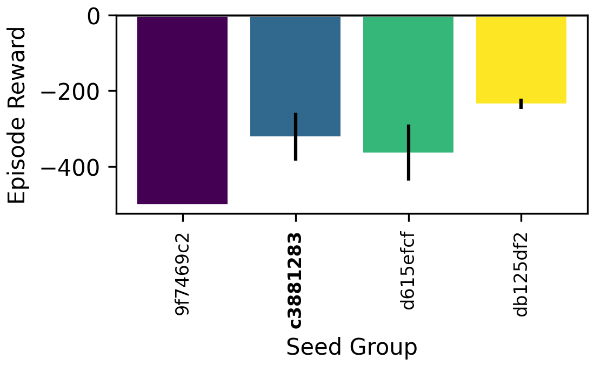](./figures/env=Acrobot-v1_type=ablation_model=c51_metric=eval-episode-reward.png) | `env=Acrobot-v1_type=ablation_model=c51_metric=eval-episode-reward` [[png](./figures/env=Acrobot-v1_type=ablation_model=c51_metric=eval-episode-reward.png), [pdf](./figures/env=Acrobot-v1_type=ablation_model=c51_metric=eval-episode-reward.pdf)] | Ablation study for C51 on Acrobot showing metric `eval-episode-reward`
[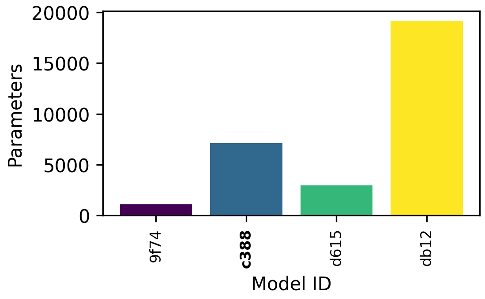](./figures/env=Acrobot-v1_type=ablation_model=c51_metric=total-model-parameter-count.png) | `env=Acrobot-v1_type=ablation_model=c51_metric=total-model-parameter-count` [[png](./figures/env=Acrobot-v1_type=ablation_model=c51_metric=total-model-parameter-count.png), [pdf](./figures/env=Acrobot-v1_type=ablation_model=c51_metric=total-model-parameter-count.pdf)] | Ablation study for C51 on Acrobot showing metric `total-model-parameter-count`
[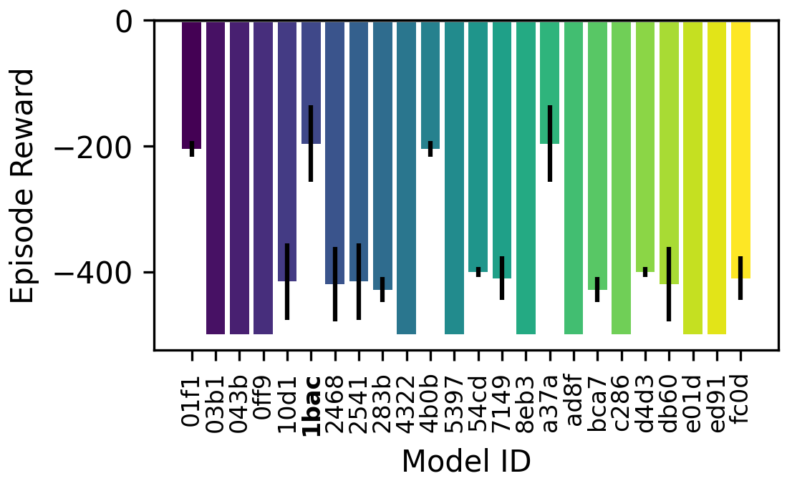](./figures/env=Acrobot-v1_type=ablation_model=qnrl_metric=eval-episode-reward.png) | `env=Acrobot-v1_type=ablation_model=qnrl_metric=eval-episode-reward` [[png](./figures/env=Acrobot-v1_type=ablation_model=qnrl_metric=eval-episode-reward.png), [pdf](./figures/env=Acrobot-v1_type=ablation_model=qnrl_metric=eval-episode-reward.pdf)] | Ablation study for QnRL on Acrobot showing metric `eval-episode-reward`
[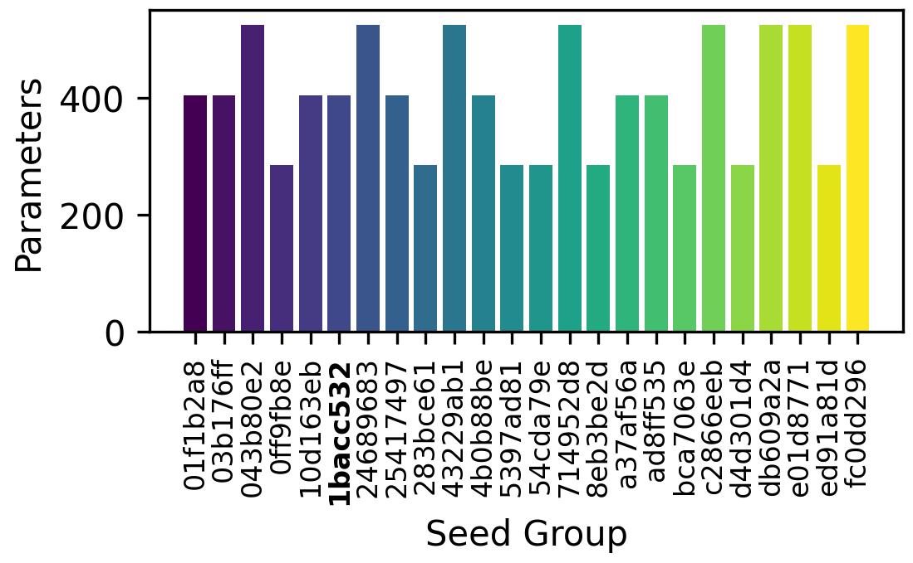](./figures/env=Acrobot-v1_type=ablation_model=qnrl_metric=total-model-parameter-count.png) | `env=Acrobot-v1_type=ablation_model=qnrl_metric=total-model-parameter-count` [[png](./figures/env=Acrobot-v1_type=ablation_model=qnrl_metric=total-model-parameter-count.png), [pdf](./figures/env=Acrobot-v1_type=ablation_model=qnrl_metric=total-model-parameter-count.pdf)] | Ablation study for QnRL on Acrobot showing metric `total-model-parameter-count`
[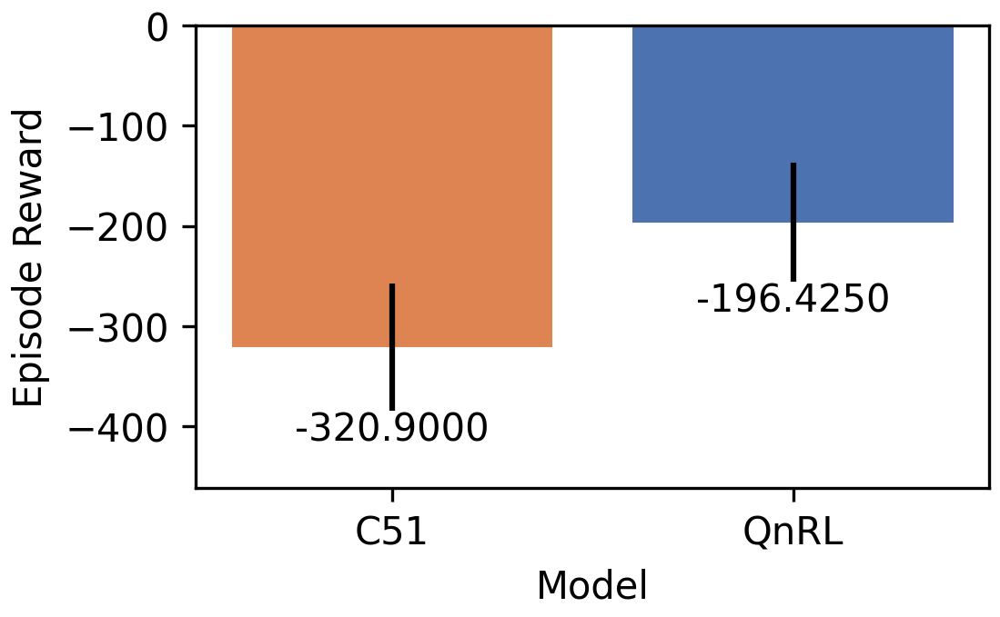](./figures/env=Acrobot-v1_type=compare-best_metric=eval-episode-reward.png) | `env=Acrobot-v1_type=compare-best_metric=eval-episode-reward` [[png](./figures/env=Acrobot-v1_type=compare-best_metric=eval-episode-reward.png), [pdf](./figures/env=Acrobot-v1_type=compare-best_metric=eval-episode-reward.pdf)] | Comparison of best models on Acrobot showing metric `eval-episode-reward`
[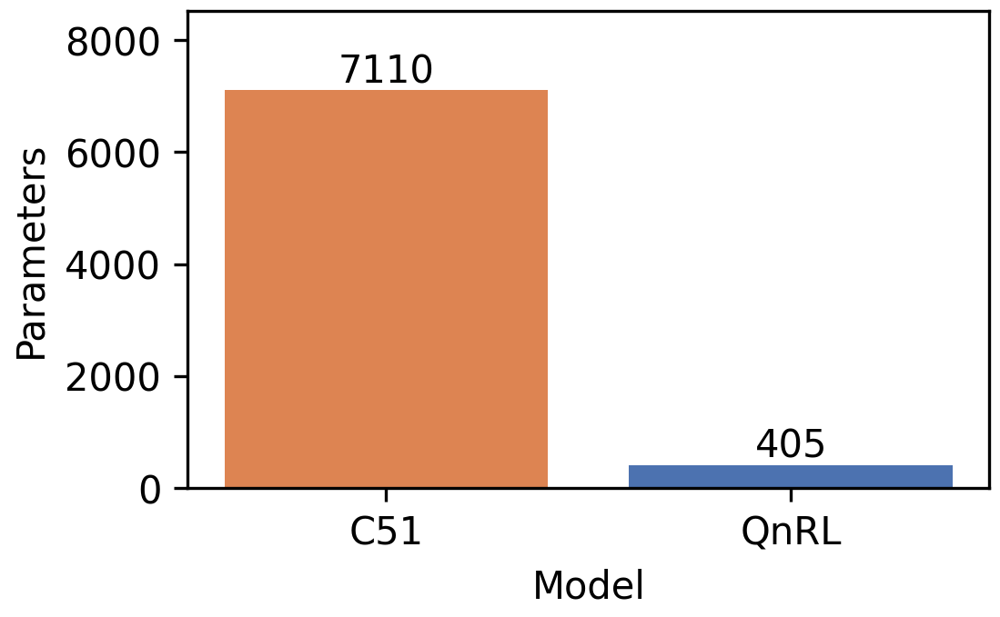](./figures/env=Acrobot-v1_type=compare-best_metric=total-model-parameter-count.png) | `env=Acrobot-v1_type=compare-best_metric=total-model-parameter-count` [[png](./figures/env=Acrobot-v1_type=compare-best_metric=total-model-parameter-count.png), [pdf](./figures/env=Acrobot-v1_type=compare-best_metric=total-model-parameter-count.pdf)] | Comparison of best models on Acrobot showing metric `total-model-parameter-count`
[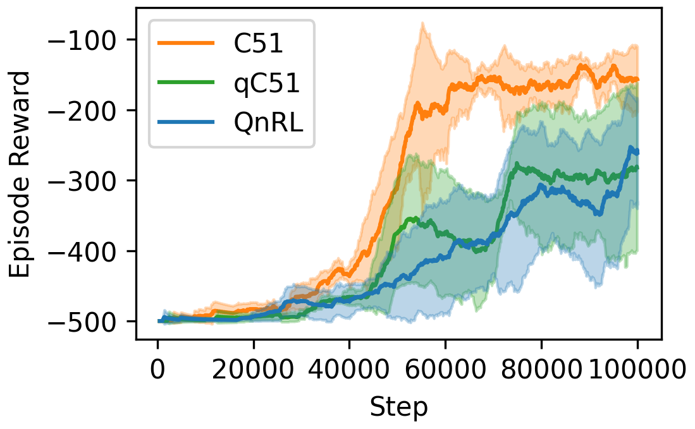](./figures/env=Acrobot-v1_type=compare-best_metric=train-episode-reward.png) | `env=Acrobot-v1_type=compare-best_metric=train-episode-reward` [[png](./figures/env=Acrobot-v1_type=compare-best_metric=train-episode-reward.png), [pdf](./figures/env=Acrobot-v1_type=compare-best_metric=train-episode-reward.pdf)] | Comparison of best models on Acrobot showing metric `train-episode-reward`
[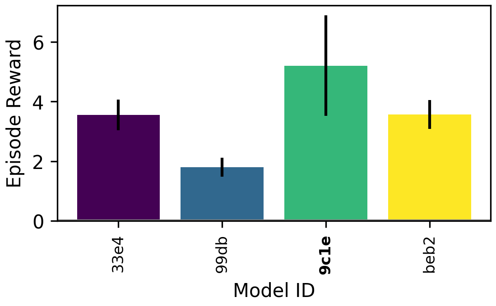](./figures/env=Breakout-v5_type=ablation_model=c51_metric=eval-episode-reward.png) | `env=Breakout-v5_type=ablation_model=c51_metric=eval-episode-reward` [[png](./figures/env=Breakout-v5_type=ablation_model=c51_metric=eval-episode-reward.png), [pdf](./figures/env=Breakout-v5_type=ablation_model=c51_metric=eval-episode-reward.pdf)] | Ablation study for C51 on Breakout showing metric `eval-episode-reward`
[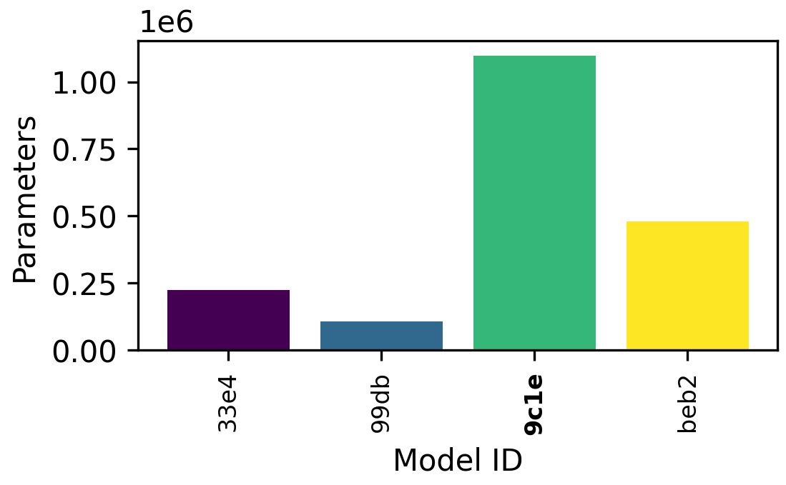](./figures/env=Breakout-v5_type=ablation_model=c51_metric=total-model-parameter-count.png) | `env=Breakout-v5_type=ablation_model=c51_metric=total-model-parameter-count` [[png](./figures/env=Breakout-v5_type=ablation_model=c51_metric=total-model-parameter-count.png), [pdf](./figures/env=Breakout-v5_type=ablation_model=c51_metric=total-model-parameter-count.pdf)] | Ablation study for C51 on Breakout showing metric `total-model-parameter-count`
[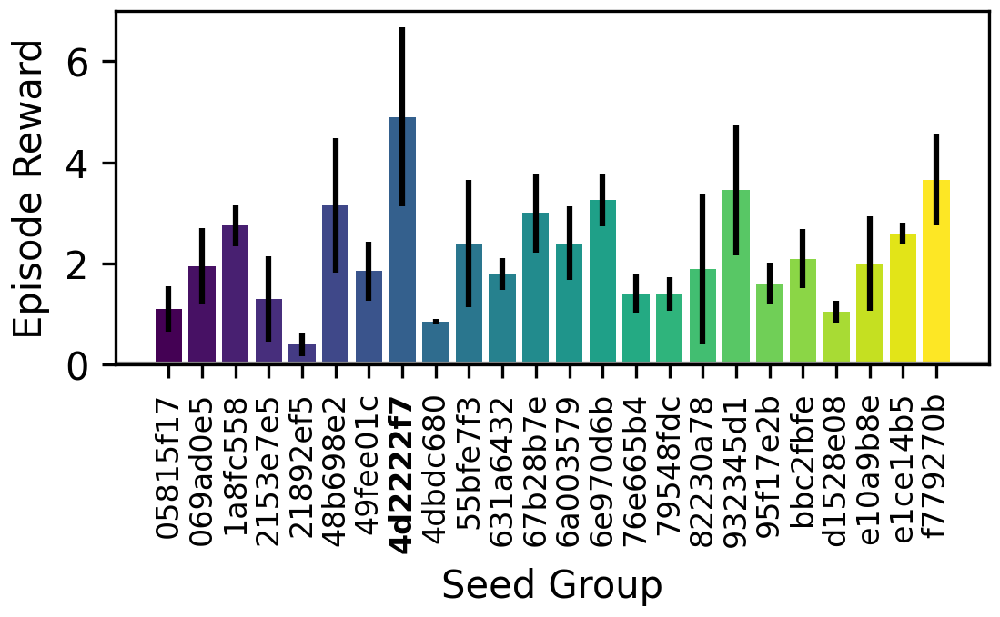](./figures/env=Breakout-v5_type=ablation_model=qnrl_metric=eval-episode-reward.png) | `env=Breakout-v5_type=ablation_model=qnrl_metric=eval-episode-reward` [[png](./figures/env=Breakout-v5_type=ablation_model=qnrl_metric=eval-episode-reward.png), [pdf](./figures/env=Breakout-v5_type=ablation_model=qnrl_metric=eval-episode-reward.pdf)] | Ablation study for QnRL on Breakout showing metric `eval-episode-reward`
[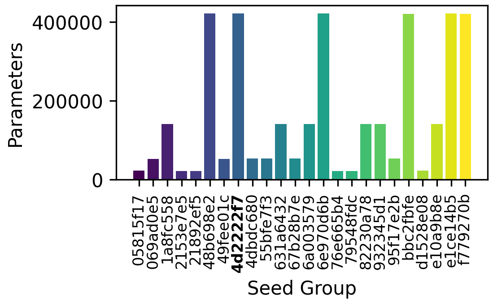](./figures/env=Breakout-v5_type=ablation_model=qnrl_metric=total-model-parameter-count.png) | `env=Breakout-v5_type=ablation_model=qnrl_metric=total-model-parameter-count` [[png](./figures/env=Breakout-v5_type=ablation_model=qnrl_metric=total-model-parameter-count.png), [pdf](./figures/env=Breakout-v5_type=ablation_model=qnrl_metric=total-model-parameter-count.pdf)] | Ablation study for QnRL on Breakout showing metric `total-model-parameter-count`
[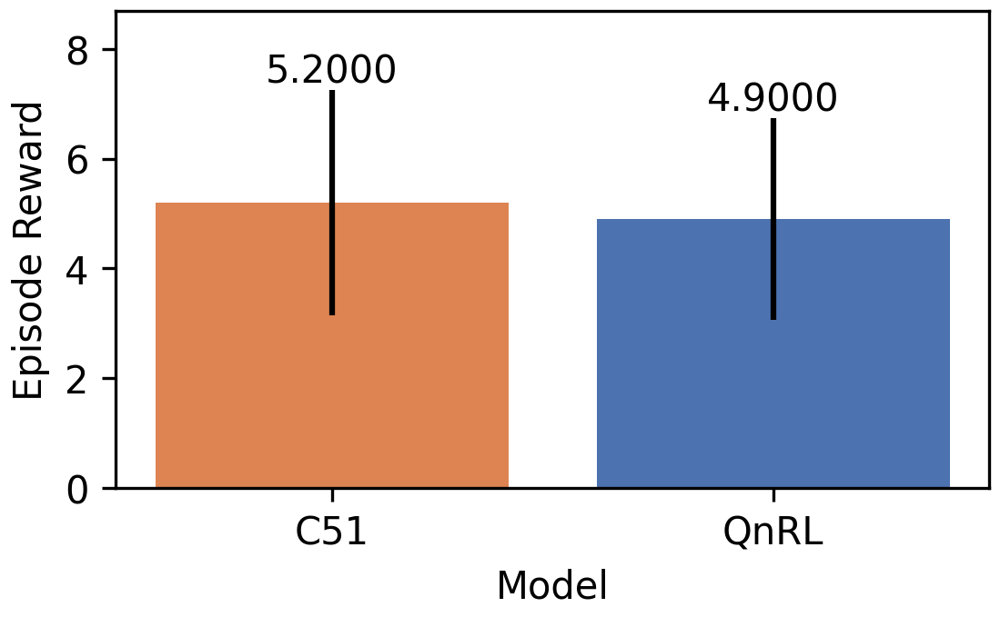](./figures/env=Breakout-v5_type=compare-best_metric=eval-episode-reward.png) | `env=Breakout-v5_type=compare-best_metric=eval-episode-reward` [[png](./figures/env=Breakout-v5_type=compare-best_metric=eval-episode-reward.png), [pdf](./figures/env=Breakout-v5_type=compare-best_metric=eval-episode-reward.pdf)] | Comparison of best models on Breakout showing metric `eval-episode-reward`
[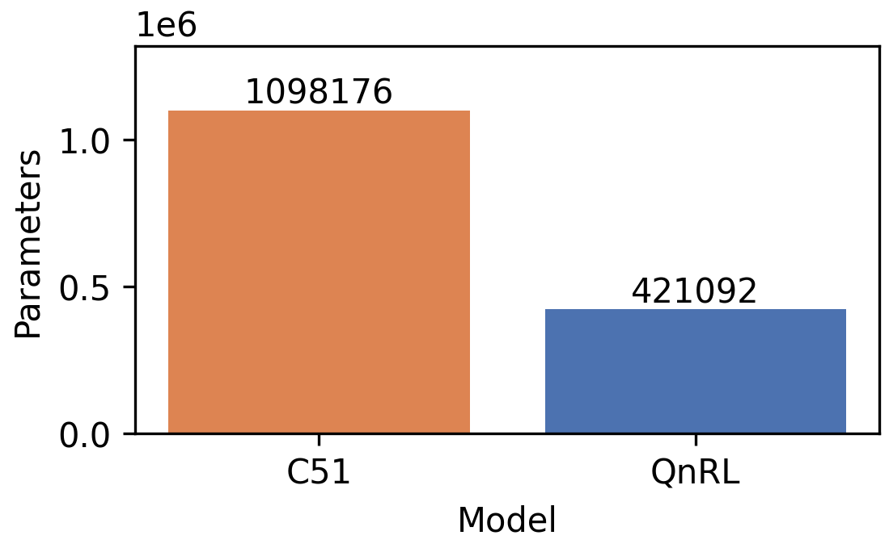](./figures/env=Breakout-v5_type=compare-best_metric=total-model-parameter-count.png) | `env=Breakout-v5_type=compare-best_metric=total-model-parameter-count` [[png](./figures/env=Breakout-v5_type=compare-best_metric=total-model-parameter-count.png), [pdf](./figures/env=Breakout-v5_type=compare-best_metric=total-model-parameter-count.pdf)] | Comparison of best models on Breakout showing metric `total-model-parameter-count`
[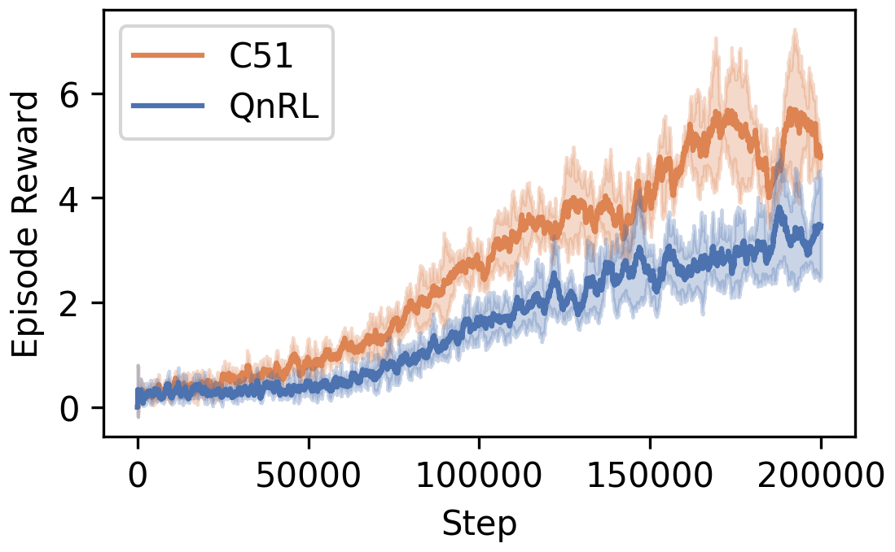](./figures/env=Breakout-v5_type=compare-best_metric=train-episode-reward.png) | `env=Breakout-v5_type=compare-best_metric=train-episode-reward` [[png](./figures/env=Breakout-v5_type=compare-best_metric=train-episode-reward.png), [pdf](./figures/env=Breakout-v5_type=compare-best_metric=train-episode-reward.pdf)] | Comparison of best models on Breakout showing metric `train-episode-reward`
[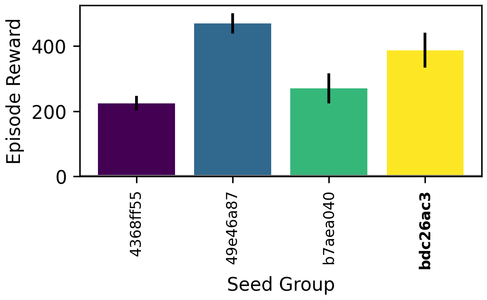](./figures/env=CartPole-v1_type=ablation_model=c51_metric=eval-episode-reward.png) | `env=CartPole-v1_type=ablation_model=c51_metric=eval-episode-reward` [[png](./figures/env=CartPole-v1_type=ablation_model=c51_metric=eval-episode-reward.png), [pdf](./figures/env=CartPole-v1_type=ablation_model=c51_metric=eval-episode-reward.pdf)] | Ablation study for C51 on CartPole showing metric `eval-episode-reward`
[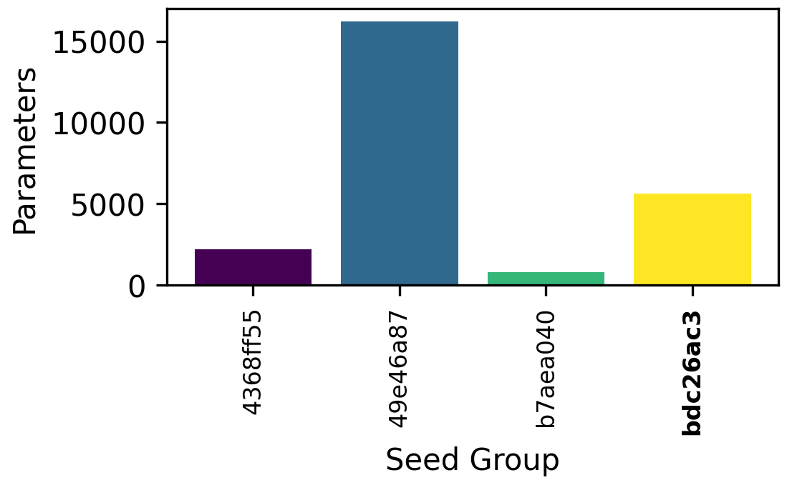](./figures/env=CartPole-v1_type=ablation_model=c51_metric=total-model-parameter-count.png) | `env=CartPole-v1_type=ablation_model=c51_metric=total-model-parameter-count` [[png](./figures/env=CartPole-v1_type=ablation_model=c51_metric=total-model-parameter-count.png), [pdf](./figures/env=CartPole-v1_type=ablation_model=c51_metric=total-model-parameter-count.pdf)] | Ablation study for C51 on CartPole showing metric `total-model-parameter-count`
[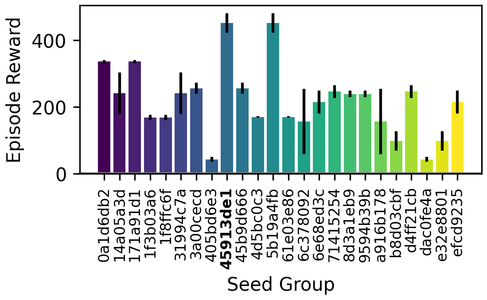](./figures/env=CartPole-v1_type=ablation_model=qnrl_metric=eval-episode-reward.png) | `env=CartPole-v1_type=ablation_model=qnrl_metric=eval-episode-reward` [[png](./figures/env=CartPole-v1_type=ablation_model=qnrl_metric=eval-episode-reward.png), [pdf](./figures/env=CartPole-v1_type=ablation_model=qnrl_metric=eval-episode-reward.pdf)] | Ablation study for QnRL on CartPole showing metric `eval-episode-reward`
[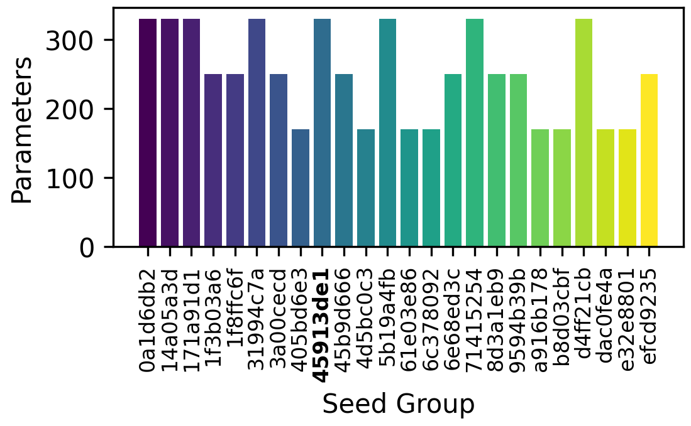](./figures/env=CartPole-v1_type=ablation_model=qnrl_metric=total-model-parameter-count.png) | `env=CartPole-v1_type=ablation_model=qnrl_metric=total-model-parameter-count` [[png](./figures/env=CartPole-v1_type=ablation_model=qnrl_metric=total-model-parameter-count.png), [pdf](./figures/env=CartPole-v1_type=ablation_model=qnrl_metric=total-model-parameter-count.pdf)] | Ablation study for QnRL on CartPole showing metric `total-model-parameter-count`
[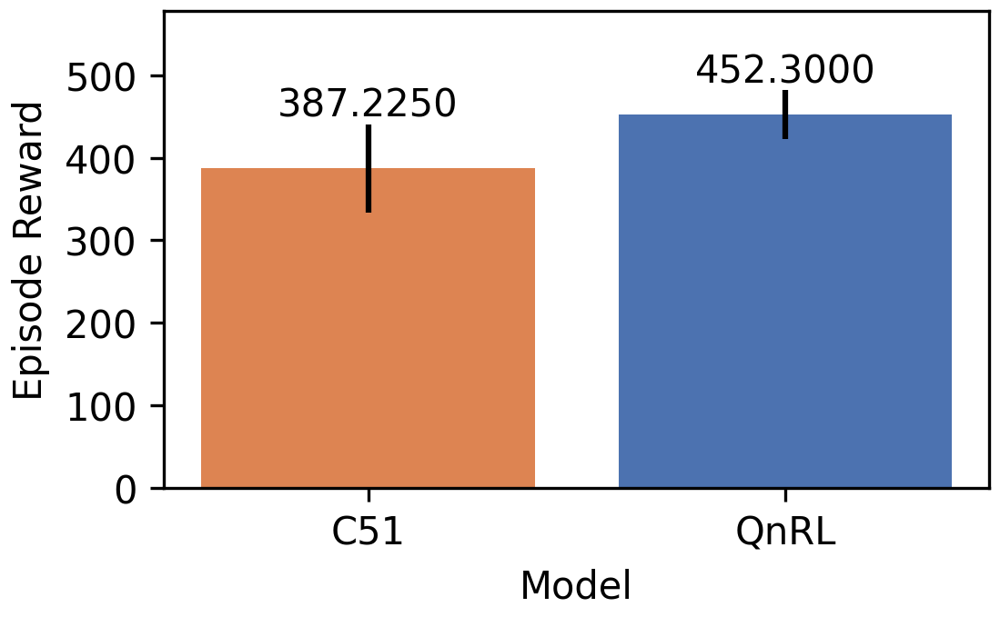](./figures/env=CartPole-v1_type=compare-best_metric=eval-episode-reward.png) | `env=CartPole-v1_type=compare-best_metric=eval-episode-reward` [[png](./figures/env=CartPole-v1_type=compare-best_metric=eval-episode-reward.png), [pdf](./figures/env=CartPole-v1_type=compare-best_metric=eval-episode-reward.pdf)] | Comparison of best models on CartPole showing metric `eval-episode-reward`
[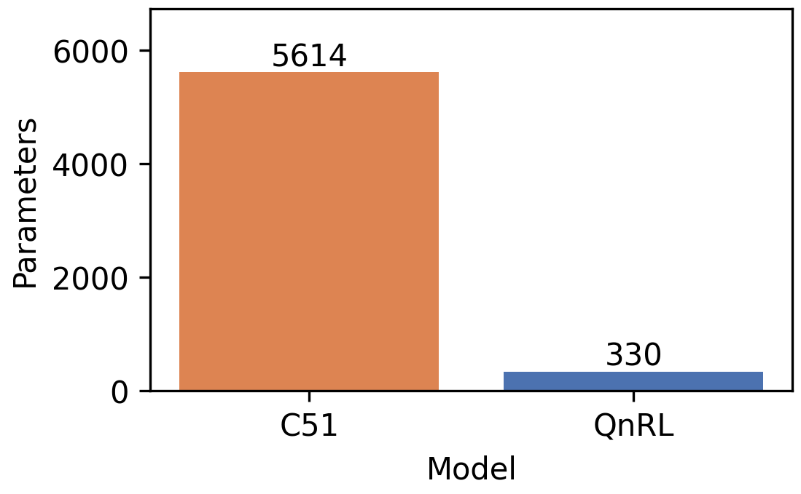](./figures/env=CartPole-v1_type=compare-best_metric=total-model-parameter-count.png) | `env=CartPole-v1_type=compare-best_metric=total-model-parameter-count` [[png](./figures/env=CartPole-v1_type=compare-best_metric=total-model-parameter-count.png), [pdf](./figures/env=CartPole-v1_type=compare-best_metric=total-model-parameter-count.pdf)] | Comparison of best models on CartPole showing metric `total-model-parameter-count`
[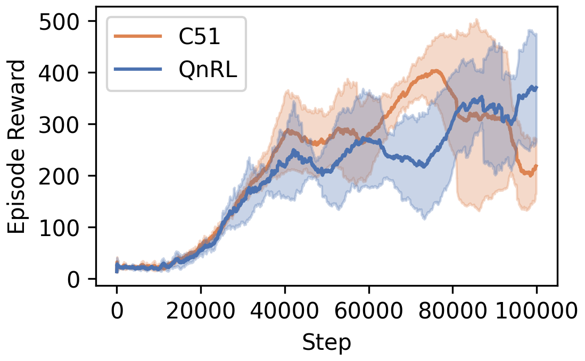](./figures/env=CartPole-v1_type=compare-best_metric=train-episode-reward.png) | `env=CartPole-v1_type=compare-best_metric=train-episode-reward` [[png](./figures/env=CartPole-v1_type=compare-best_metric=train-episode-reward.png), [pdf](./figures/env=CartPole-v1_type=compare-best_metric=train-episode-reward.pdf)] | Comparison of best models on CartPole showing metric `train-episode-reward`
[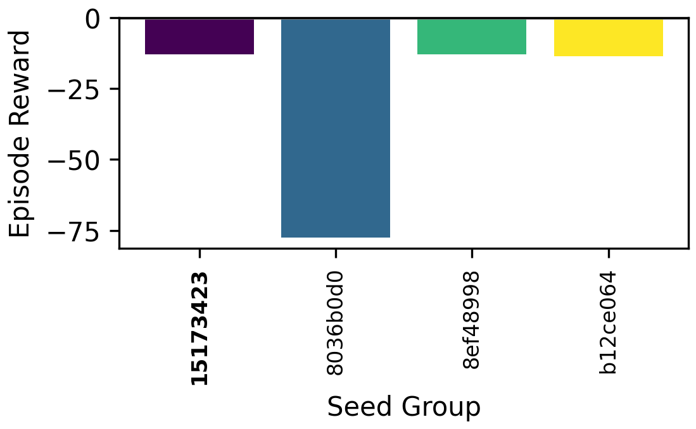](./figures/env=CliffWalking-v1_type=ablation_model=c51_metric=eval-episode-reward.png) | `env=CliffWalking-v1_type=ablation_model=c51_metric=eval-episode-reward` [[png](./figures/env=CliffWalking-v1_type=ablation_model=c51_metric=eval-episode-reward.png), [pdf](./figures/env=CliffWalking-v1_type=ablation_model=c51_metric=eval-episode-reward.pdf)] | Ablation study for C51 on CliffWalking showing metric `eval-episode-reward`
[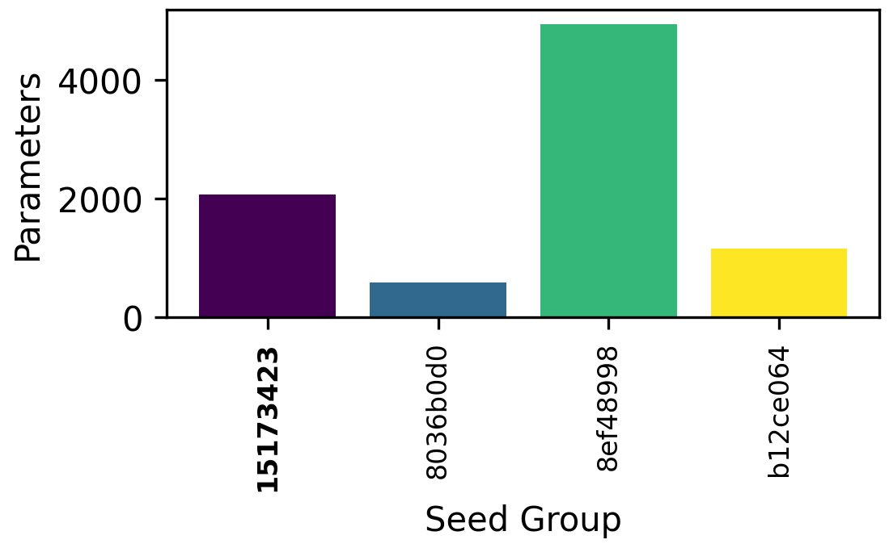](./figures/env=CliffWalking-v1_type=ablation_model=c51_metric=total-model-parameter-count.png) | `env=CliffWalking-v1_type=ablation_model=c51_metric=total-model-parameter-count` [[png](./figures/env=CliffWalking-v1_type=ablation_model=c51_metric=total-model-parameter-count.png), [pdf](./figures/env=CliffWalking-v1_type=ablation_model=c51_metric=total-model-parameter-count.pdf)] | Ablation study for C51 on CliffWalking showing metric `total-model-parameter-count`
[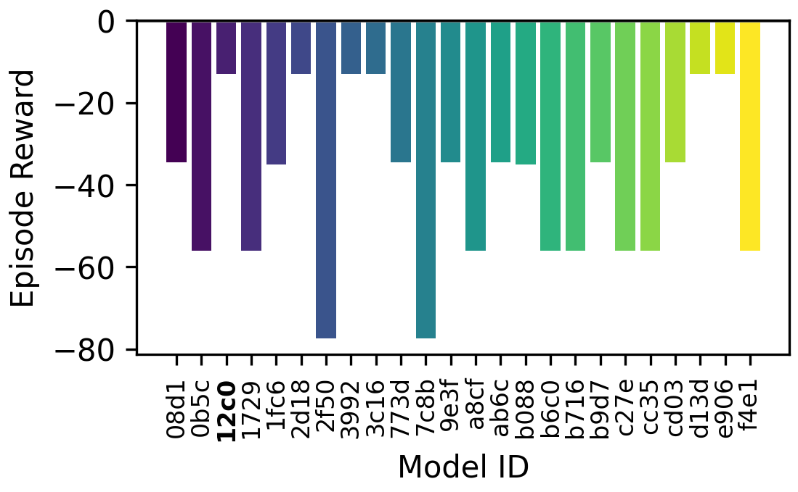](./figures/env=CliffWalking-v1_type=ablation_model=qnrl_metric=eval-episode-reward.png) | `env=CliffWalking-v1_type=ablation_model=qnrl_metric=eval-episode-reward` [[png](./figures/env=CliffWalking-v1_type=ablation_model=qnrl_metric=eval-episode-reward.png), [pdf](./figures/env=CliffWalking-v1_type=ablation_model=qnrl_metric=eval-episode-reward.pdf)] | Ablation study for QnRL on CliffWalking showing metric `eval-episode-reward`
[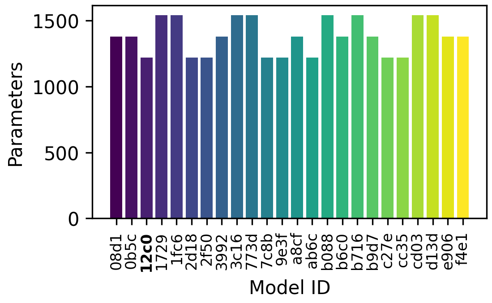](./figures/env=CliffWalking-v1_type=ablation_model=qnrl_metric=total-model-parameter-count.png) | `env=CliffWalking-v1_type=ablation_model=qnrl_metric=total-model-parameter-count` [[png](./figures/env=CliffWalking-v1_type=ablation_model=qnrl_metric=total-model-parameter-count.png), [pdf](./figures/env=CliffWalking-v1_type=ablation_model=qnrl_metric=total-model-parameter-count.pdf)] | Ablation study for QnRL on CliffWalking showing metric `total-model-parameter-count`
[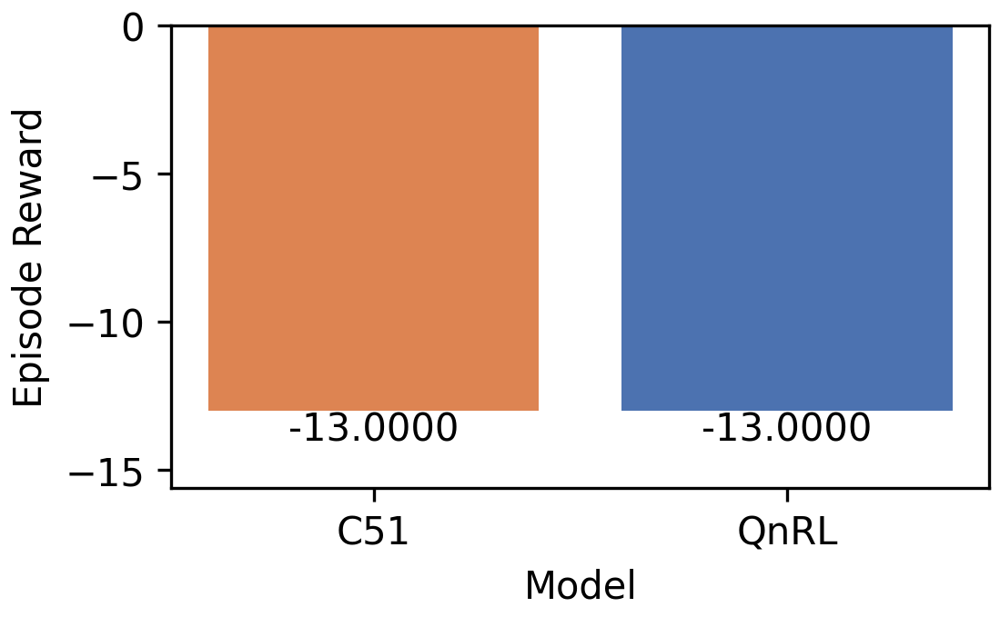](./figures/env=CliffWalking-v1_type=compare-best_metric=eval-episode-reward.png) | `env=CliffWalking-v1_type=compare-best_metric=eval-episode-reward` [[png](./figures/env=CliffWalking-v1_type=compare-best_metric=eval-episode-reward.png), [pdf](./figures/env=CliffWalking-v1_type=compare-best_metric=eval-episode-reward.pdf)] | Comparison of best models on CliffWalking showing metric `eval-episode-reward`
[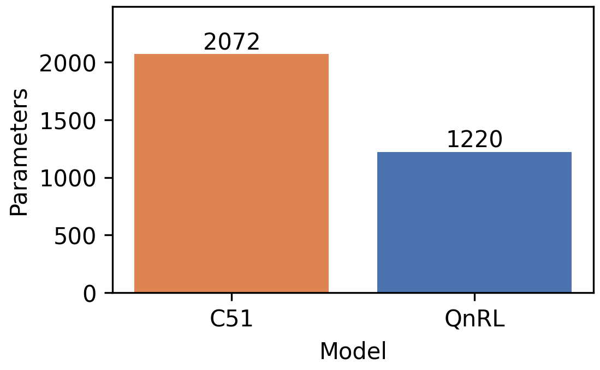](./figures/env=CliffWalking-v1_type=compare-best_metric=total-model-parameter-count.png) | `env=CliffWalking-v1_type=compare-best_metric=total-model-parameter-count` [[png](./figures/env=CliffWalking-v1_type=compare-best_metric=total-model-parameter-count.png), [pdf](./figures/env=CliffWalking-v1_type=compare-best_metric=total-model-parameter-count.pdf)] | Comparison of best models on CliffWalking showing metric `total-model-parameter-count`
[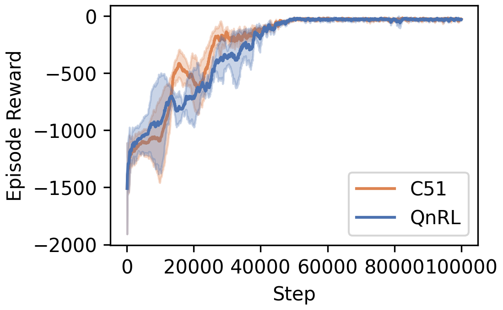](./figures/env=CliffWalking-v1_type=compare-best_metric=train-episode-reward.png) | `env=CliffWalking-v1_type=compare-best_metric=train-episode-reward` [[png](./figures/env=CliffWalking-v1_type=compare-best_metric=train-episode-reward.png), [pdf](./figures/env=CliffWalking-v1_type=compare-best_metric=train-episode-reward.pdf)] | Comparison of best models on CliffWalking showing metric `train-episode-reward`
[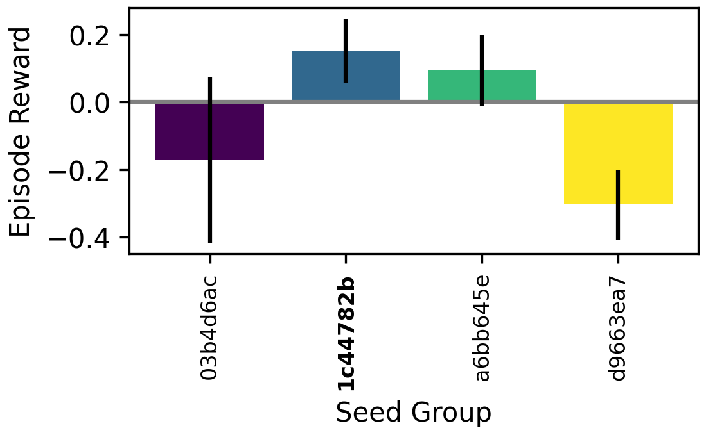](./figures/env=FrozenLake-v1_type=ablation_model=c51_metric=eval-episode-reward.png) | `env=FrozenLake-v1_type=ablation_model=c51_metric=eval-episode-reward` [[png](./figures/env=FrozenLake-v1_type=ablation_model=c51_metric=eval-episode-reward.png), [pdf](./figures/env=FrozenLake-v1_type=ablation_model=c51_metric=eval-episode-reward.pdf)] | Ablation study for C51 on FrozenLake showing metric `eval-episode-reward`
[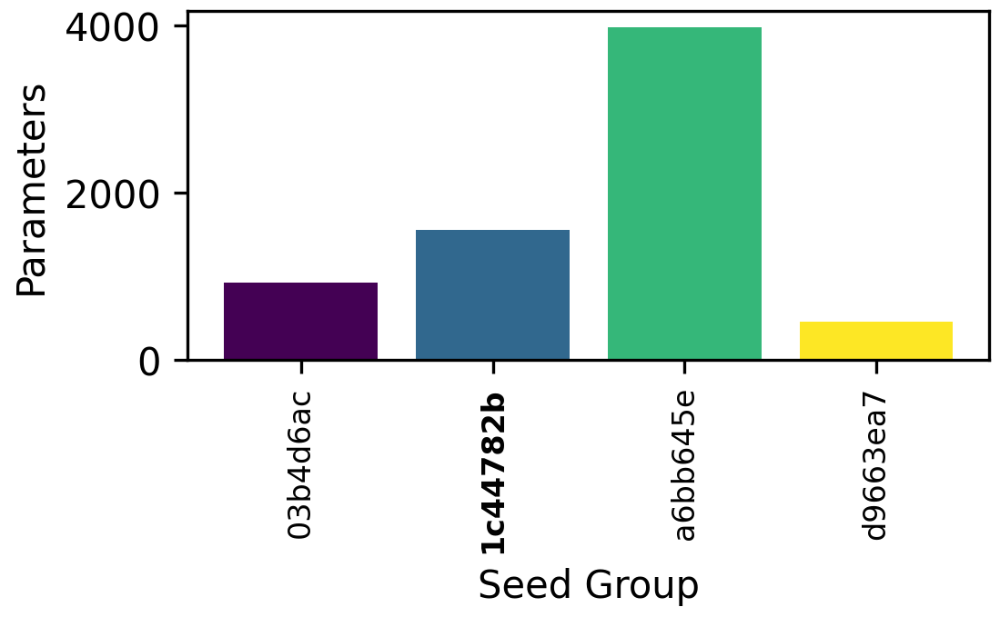](./figures/env=FrozenLake-v1_type=ablation_model=c51_metric=total-model-parameter-count.png) | `env=FrozenLake-v1_type=ablation_model=c51_metric=total-model-parameter-count` [[png](./figures/env=FrozenLake-v1_type=ablation_model=c51_metric=total-model-parameter-count.png), [pdf](./figures/env=FrozenLake-v1_type=ablation_model=c51_metric=total-model-parameter-count.pdf)] | Ablation study for C51 on FrozenLake showing metric `total-model-parameter-count`
[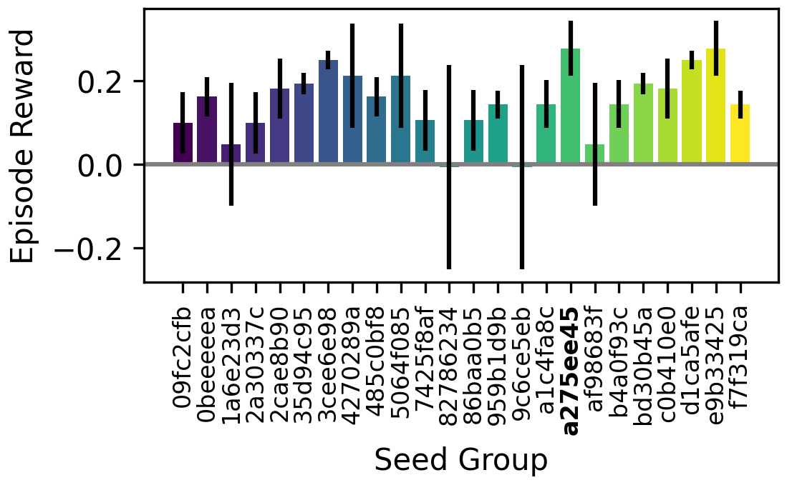](./figures/env=FrozenLake-v1_type=ablation_model=qnrl_metric=eval-episode-reward.png) | `env=FrozenLake-v1_type=ablation_model=qnrl_metric=eval-episode-reward` [[png](./figures/env=FrozenLake-v1_type=ablation_model=qnrl_metric=eval-episode-reward.png), [pdf](./figures/env=FrozenLake-v1_type=ablation_model=qnrl_metric=eval-episode-reward.pdf)] | Ablation study for QnRL on FrozenLake showing metric `eval-episode-reward`
[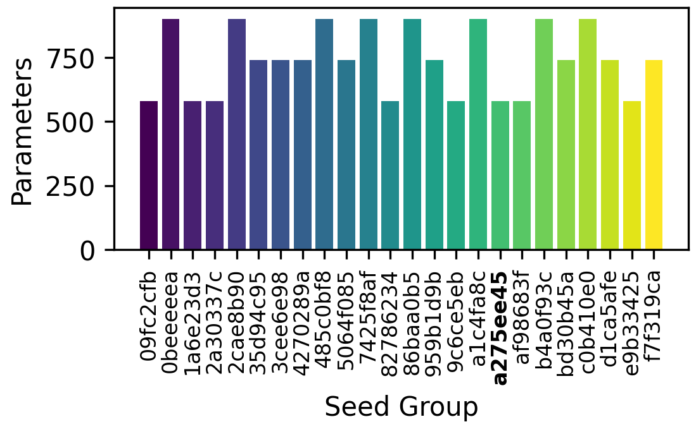](./figures/env=FrozenLake-v1_type=ablation_model=qnrl_metric=total-model-parameter-count.png) | `env=FrozenLake-v1_type=ablation_model=qnrl_metric=total-model-parameter-count` [[png](./figures/env=FrozenLake-v1_type=ablation_model=qnrl_metric=total-model-parameter-count.png), [pdf](./figures/env=FrozenLake-v1_type=ablation_model=qnrl_metric=total-model-parameter-count.pdf)] | Ablation study for QnRL on FrozenLake showing metric `total-model-parameter-count`
[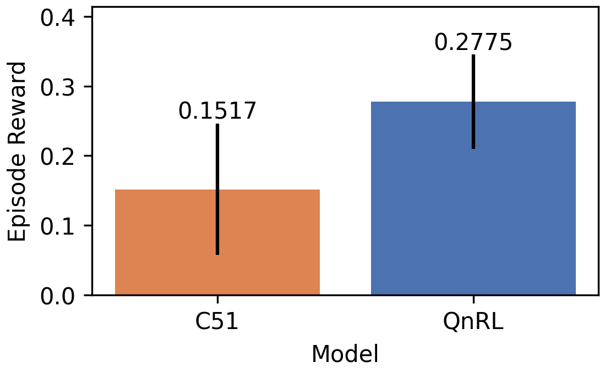](./figures/env=FrozenLake-v1_type=compare-best_metric=eval-episode-reward.png) | `env=FrozenLake-v1_type=compare-best_metric=eval-episode-reward` [[png](./figures/env=FrozenLake-v1_type=compare-best_metric=eval-episode-reward.png), [pdf](./figures/env=FrozenLake-v1_type=compare-best_metric=eval-episode-reward.pdf)] | Comparison of best models on FrozenLake showing metric `eval-episode-reward`
[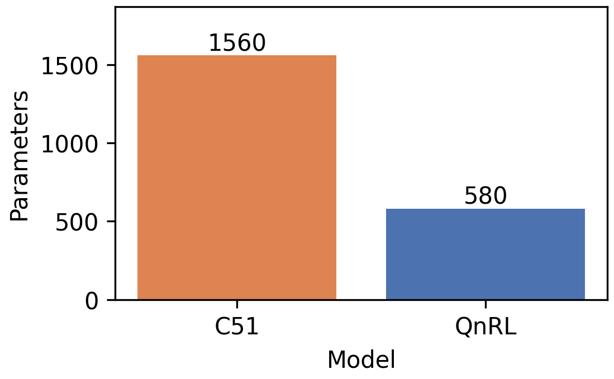](./figures/env=FrozenLake-v1_type=compare-best_metric=total-model-parameter-count.png) | `env=FrozenLake-v1_type=compare-best_metric=total-model-parameter-count` [[png](./figures/env=FrozenLake-v1_type=compare-best_metric=total-model-parameter-count.png), [pdf](./figures/env=FrozenLake-v1_type=compare-best_metric=total-model-parameter-count.pdf)] | Comparison of best models on FrozenLake showing metric `total-model-parameter-count`
[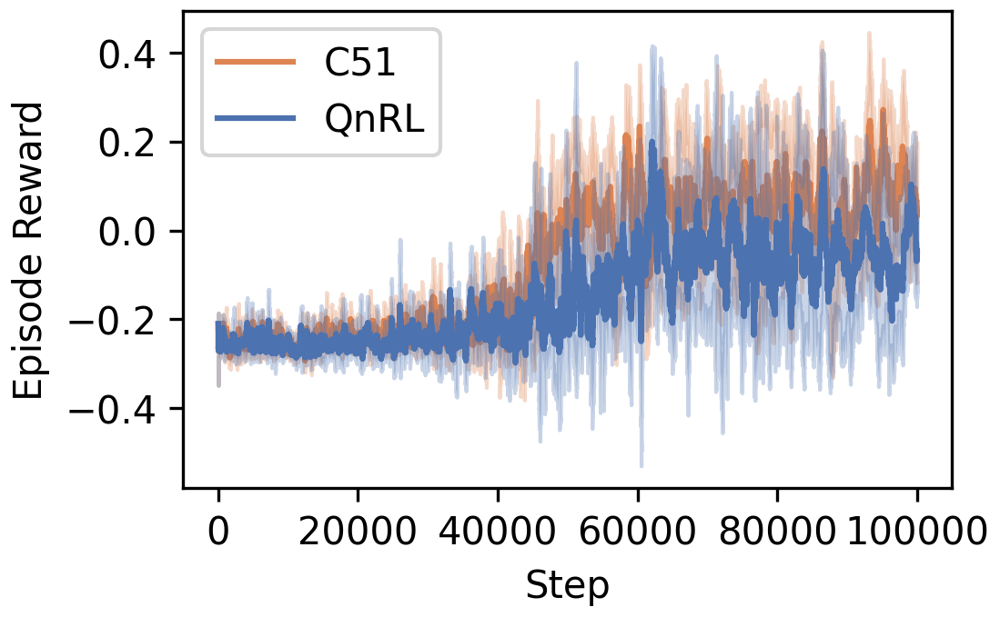](./figures/env=FrozenLake-v1_type=compare-best_metric=train-episode-reward.png) | `env=FrozenLake-v1_type=compare-best_metric=train-episode-reward` [[png](./figures/env=FrozenLake-v1_type=compare-best_metric=train-episode-reward.png), [pdf](./figures/env=FrozenLake-v1_type=compare-best_metric=train-episode-reward.pdf)] | Comparison of best models on FrozenLake showing metric `train-episode-reward`
[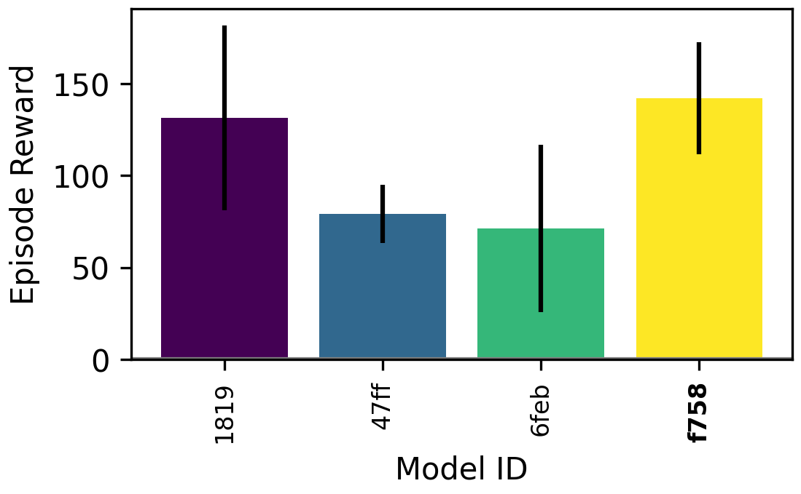](./figures/env=SpaceInvaders-v5_type=ablation_model=c51_metric=eval-episode-reward.png) | `env=SpaceInvaders-v5_type=ablation_model=c51_metric=eval-episode-reward` [[png](./figures/env=SpaceInvaders-v5_type=ablation_model=c51_metric=eval-episode-reward.png), [pdf](./figures/env=SpaceInvaders-v5_type=ablation_model=c51_metric=eval-episode-reward.pdf)] | Ablation study for C51 on SpaceInvaders showing metric `eval-episode-reward`
[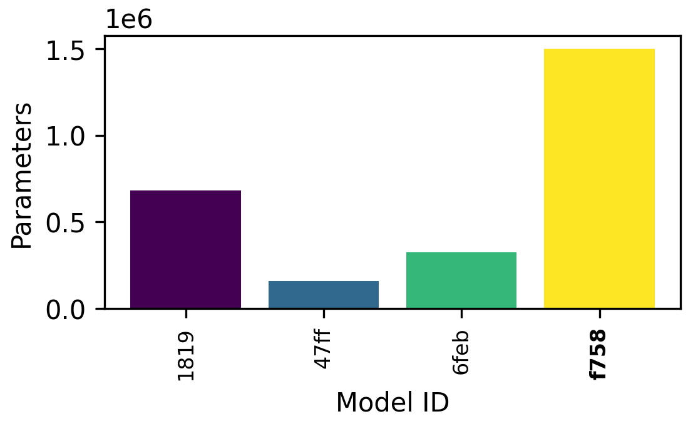](./figures/env=SpaceInvaders-v5_type=ablation_model=c51_metric=total-model-parameter-count.png) | `env=SpaceInvaders-v5_type=ablation_model=c51_metric=total-model-parameter-count` [[png](./figures/env=SpaceInvaders-v5_type=ablation_model=c51_metric=total-model-parameter-count.png), [pdf](./figures/env=SpaceInvaders-v5_type=ablation_model=c51_metric=total-model-parameter-count.pdf)] | Ablation study for C51 on SpaceInvaders showing metric `total-model-parameter-count`
[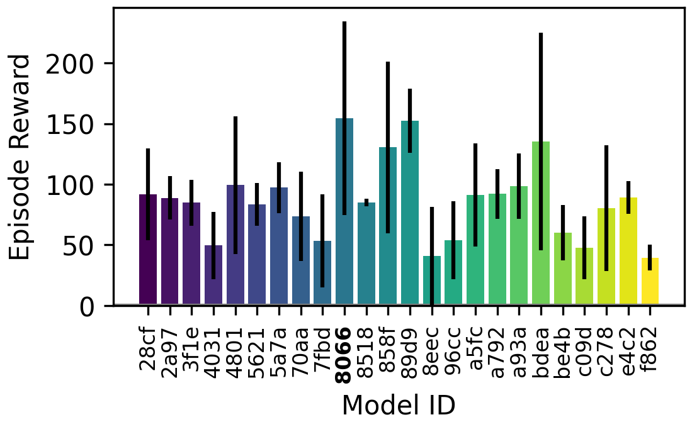](./figures/env=SpaceInvaders-v5_type=ablation_model=qnrl_metric=eval-episode-reward.png) | `env=SpaceInvaders-v5_type=ablation_model=qnrl_metric=eval-episode-reward` [[png](./figures/env=SpaceInvaders-v5_type=ablation_model=qnrl_metric=eval-episode-reward.png), [pdf](./figures/env=SpaceInvaders-v5_type=ablation_model=qnrl_metric=eval-episode-reward.pdf)] | Ablation study for QnRL on SpaceInvaders showing metric `eval-episode-reward`
[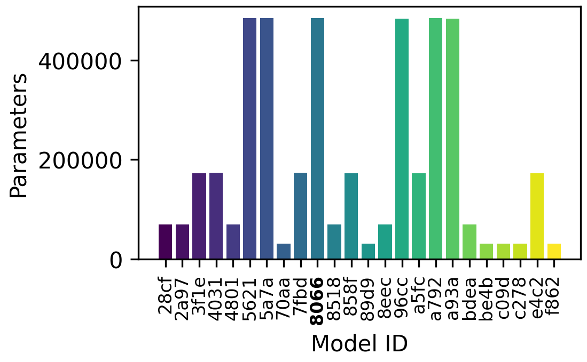](./figures/env=SpaceInvaders-v5_type=ablation_model=qnrl_metric=total-model-parameter-count.png) | `env=SpaceInvaders-v5_type=ablation_model=qnrl_metric=total-model-parameter-count` [[png](./figures/env=SpaceInvaders-v5_type=ablation_model=qnrl_metric=total-model-parameter-count.png), [pdf](./figures/env=SpaceInvaders-v5_type=ablation_model=qnrl_metric=total-model-parameter-count.pdf)] | Ablation study for QnRL on SpaceInvaders showing metric `total-model-parameter-count`
[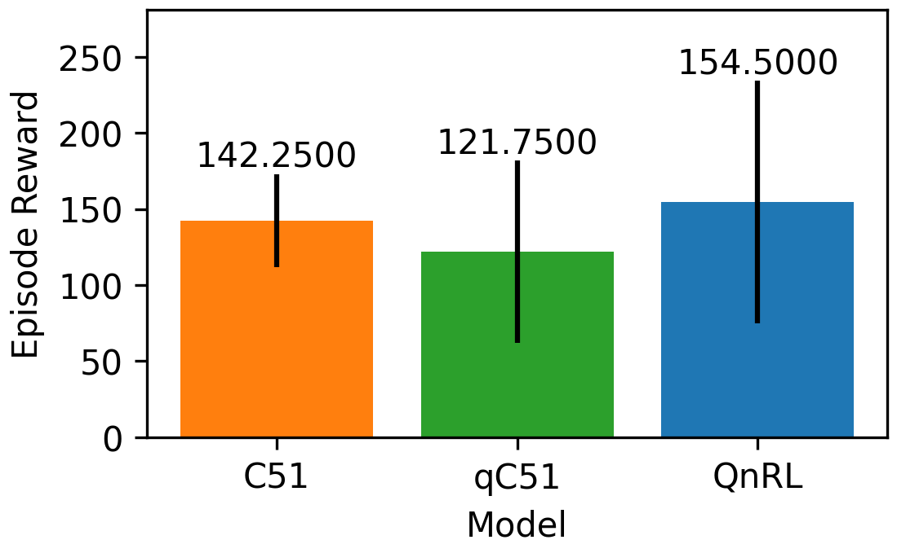](./figures/env=SpaceInvaders-v5_type=compare-best_metric=eval-episode-reward.png) | `env=SpaceInvaders-v5_type=compare-best_metric=eval-episode-reward` [[png](./figures/env=SpaceInvaders-v5_type=compare-best_metric=eval-episode-reward.png), [pdf](./figures/env=SpaceInvaders-v5_type=compare-best_metric=eval-episode-reward.pdf)] | Comparison of best models on SpaceInvaders showing metric `eval-episode-reward`
[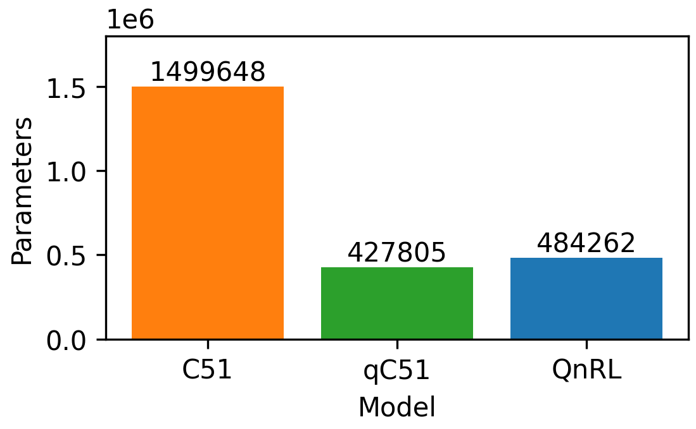](./figures/env=SpaceInvaders-v5_type=compare-best_metric=total-model-parameter-count.png) | `env=SpaceInvaders-v5_type=compare-best_metric=total-model-parameter-count` [[png](./figures/env=SpaceInvaders-v5_type=compare-best_metric=total-model-parameter-count.png), [pdf](./figures/env=SpaceInvaders-v5_type=compare-best_metric=total-model-parameter-count.pdf)] | Comparison of best models on SpaceInvaders showing metric `total-model-parameter-count`
[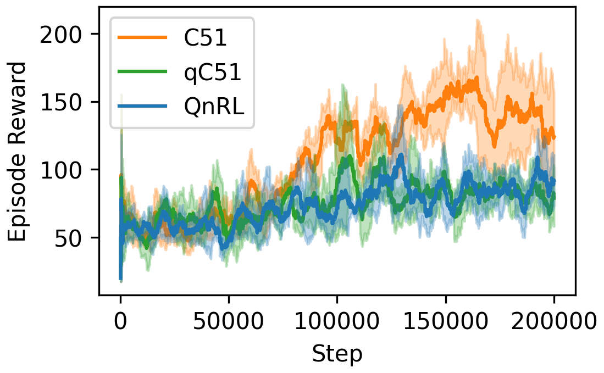](./figures/env=SpaceInvaders-v5_type=compare-best_metric=train-episode-reward.png) | `env=SpaceInvaders-v5_type=compare-best_metric=train-episode-reward` [[png](./figures/env=SpaceInvaders-v5_type=compare-best_metric=train-episode-reward.png), [pdf](./figures/env=SpaceInvaders-v5_type=compare-best_metric=train-episode-reward.pdf)] | Comparison of best models on SpaceInvaders showing metric `train-episode-reward`


## Authors

- [zanderman](https://github.com/zanderman) [](https://github.com/zanderman)
- [saadwalid](https://github.com/saadwalid) [](https://github.com/saadwalid)